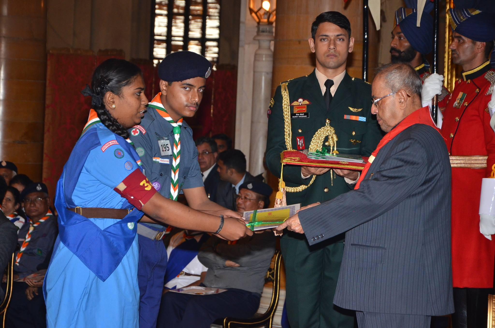

## About Me

I am an M.Sc. student in **Data Science and Artificial Intelligence (DSAI)** at [Saarland University](https://www.uni-saarland.de/en/home.html), Germany. I am currently a **Student Research Assistant** in the Trustworthy ML group at [CISPA Helmholtz Center for Information Security](https://cispa.de/en/research/groups/fritz), in the group of [Prof. Dr. Mario Fritz](https://cispa.saarland/group/fritz/). I am also a **Research Fellow** in the Fall 2026 cohort of **SPAR (Supervised Program for Alignment Research)**, where I work on *moral shadowbanning* — whether conversational AI provides systematically different levels of helpfulness, honesty, or harmlessness to users perceived as having poor moral character. I was a Research Fellow at the [AI Safety Saarland Incubator](https://www.ais-saarland.org/) and a Student Research Assistant at [DFKI](https://www.dfki.de/en/web) in the Interactive Machine Learning group.

My research interests lie broadly in **AI safety**, particularly the evaluation of autonomous AI agents, understanding their failure modes, and how they interact with people over extended periods. My work spans LLM safety evaluation, bias in AI-assisted decision-making, and long-term personalization through memory. I am particularly interested in how AI agents can use personal information appropriately as user preferences, relationships, and contexts change over time.

## Research Interests

- **AI Safety and Evaluation:** Understanding failure modes, biases, and safety risks in language models and autonomous AI agents.
- **Contextual Integrity and Agent Safety:** Studying how AI agents should use and share information appropriately across different contexts, including privacy and changing user permissions.
- **Long-Term Memory and Personalization:** Exploring how agents maintain, update, and retrieve personal information over extended interactions, including conflicting or outdated memories.
- **Human–AI Interaction:** Understanding how AI systems influence users and how their behavior can be evaluated in realistic, long-term settings.

## News

- **[Sep. 2026]** Selected as a **Research Fellow** in the Fall 2026 cohort of **SPAR (Supervised Program for Alignment Research)**.
- **[Jul. 2026]** Served as a **Student Volunteer** at **ACL 2026** in San Diego, USA.
- **[Jul. 2026]** Reviewing for the **NeurIPS 2026 Evaluations & Datasets Track**.
- **[Apr. 2026]** Paper *"Justice in Judgment: Unveiling (Hidden) Bias in LLM-assisted Peer Reviews"* accepted to **ACL 2026 Findings**.
- **[Apr. 2026]** Awarded the **Saarland Scholarship for International Students** (Summer Semester 2026).
- **[Feb. 2026]** Paper *"Challenges of Evaluating LLM Safety for User Welfare"* accepted to **IASEAI'26**.
- **[Dec. 2025]** Started as **Student Research Assistant** at **CISPA Helmholtz Center for Information Security** (Trustworthy ML group).
- **[Nov. 2025]** Paper *"Justice in Judgment: Unveiling (Hidden) Bias in LLM-assisted Peer Reviews"* presented at **NeurIPS 2025 Workshop on LLM Evaluation**.
- **[Nov. 2025]** Paper *"AuditCopilot: Leveraging LLMs for Fraud Detection in Double-Entry Bookkeeping"* presented at **NeurIPS 2025 Workshop on Generative AI in Finance**.
- **[Oct. 2025]** Selected as **Research Fellow** at the **AI Safety Saarland Incubator**.
- **[Jul. 2025]** Awarded the **Saarland Scholarship for International Students** (Summer Semester 2025).



## Beyond Research

I am an avid traveller — having explored 15+ countries across the world. Outside of academia, I enjoy staying updated on the latest in tech and culture through [X](https://x.com), and I am a big movie buff.

I am also a proud **President Scout Awardee**, having received the highest scouting honour in India from the Former President of India in December 2016.

  

